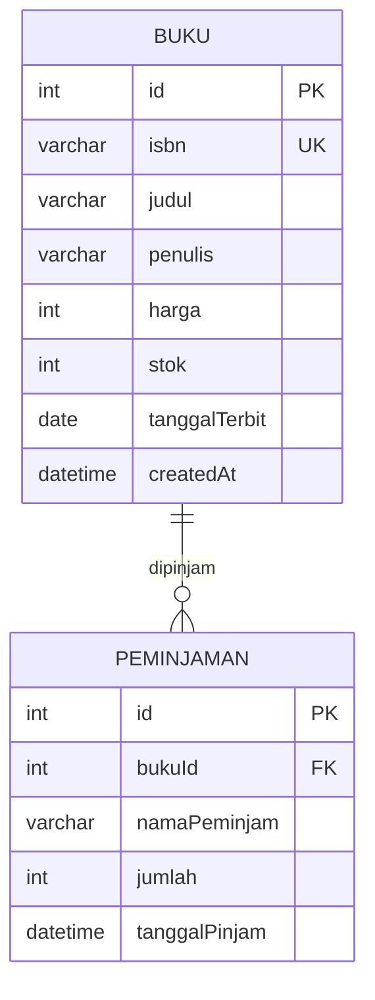

# Books API — Mini Project ETS Pemrograman Web Lanjut

REST API CRUD untuk data buku dan peminjaman, dibangun dengan **Express.js + MySQL + Prisma**.

## Identitas

|                       |                                |
| --------------------- | ------------------------------ |
| Nama                  | **Rakasya Yoga Surya Pratama** |
| NIM                   | **F1D02310022**                |
| Kelas                 | Tidak dicantumkan              |
| Kasus yang dipilih    | Books API (buku + peminjaman)  |
| Link video presentasi | Belum dicantumkan              |

## Teknologi

- Node.js 24 (JavaScript ES Module)
- Express.js 5
- MySQL (diakses lewat phpMyAdmin / Laragon)
- Prisma 7 (ORM, migrasi, seed) dengan `@prisma/adapter-mariadb`
- Joi (validasi), dotenv (konfigurasi)

## Cara Menjalankan

1. **Buat database kosong** di phpMyAdmin bernama `pwl26_buku` (collation `utf8mb4_unicode_ci`).
2. **Pasang paket:**
   ```bash
   npm install
   ```
3. **Buat file `.env`** dari contoh, lalu sesuaikan `DATABASE_URL` dengan MySQL di komputer kamu (user, password, port):
   ```bash
   cp .env.example .env
   ```
4. **Jalankan migrasi** (membuat tabel dari folder `prisma/migrations`), lalu **generate Prisma Client**:
   ```bash
   npx prisma migrate dev
   npx prisma generate
   ```
5. **Isi data awal (seed)**. Boleh dijalankan berulang kali tanpa data dobel:
   ```bash
   npx prisma db seed
   ```
6. **Jalankan server:**
   ```bash
   npm run dev
   ```
   Server berjalan di `http://localhost:3000`.

Pengujian: buka `requests.http` di VS Code (ekstensi **REST Client**), lalu klik _Send Request_ pada tiap blok. Variabel `@namaSaya` pada bagian atas file digunakan untuk mencantumkan identitas saat pengujian. Sesuaikan nilainya dengan nama dan NIM sebelum menjalankan request.

## Struktur Proyek

```
pwl26-mini-project/
├── index.js                      # susun middleware global + pasang router
├── prisma.config.js              # lokasi skema, database, perintah seed
├── prisma/
│   ├── schema.prisma             # model Buku dan Peminjaman
│   ├── migrations/               # riwayat migrasi (di-commit)
│   └── seed.js                   # data awal yang bisa diulang
├── src/
│   ├── routes/                   # peta URL + middleware -> controller
│   ├── controllers/              # baca req, panggil service, kirim res
│   ├── services/                 # aturan bisnis + transaksi
│   ├── data/                     # akses database (Prisma)
│   ├── middleware/               # logger, validasi, notFound, errorHandler
│   ├── validators/               # skema Joi
│   ├── utils/AppError.js         # error dengan status + kode
│   └── lib/prisma.js             # koneksi Prisma
├── requests.http                 # kumpulan uji API (berhasil + gagal)
├── screenshot/                   # bukti hasil uji
├── .env.example
└── README.md
```

Alur satu permintaan:

```
express.json -> logger -> router -> validasi -> controller -> service -> data -> MySQL
                                                      (error apa pun) -> notFound / errorHandler
```

## Desain Basis Data



- **Tabel utama `buku`**: 8 kolom. Kolom angka: `harga`, `stok`. Kolom tanggal: `tanggalTerbit`, `createdAt`. Kolom teks unik: `isbn`.
- **Tabel kedua `peminjaman`**: relasi satu-ke-banyak (satu buku bisa dipinjam berkali-kali), foreign key `bukuId`.
- Migrasi: `prisma/migrations/20261111080000_buat_tabel_buku_peminjaman`.
- Seed: 12 buku dan 2 peminjaman. Buku id 6 (_Clean Code_) sengaja berstok 1 untuk menguji kasus stok tidak cukup.

## Daftar Endpoint

### Buku

| Method | URL         | Keterangan                     | Status                  |
| ------ | ----------- | ------------------------------ | ----------------------- |
| GET    | `/buku`     | Daftar buku, paginasi + filter | 200                     |
| GET    | `/buku/:id` | Detail satu buku               | 200, 400, 404           |
| POST   | `/buku`     | Tambah buku                    | 201, 409, 422           |
| PUT    | `/buku/:id` | Ubah buku (semua field)        | 200, 400, 404, 409, 422 |
| DELETE | `/buku/:id` | Hapus buku                     | 204, 400, 404, 409      |

**Query `GET /buku`:**

| Parameter | Default | Keterangan                                 |
| --------- | ------- | ------------------------------------------ |
| `halaman` | 1       | Nomor halaman                              |
| `ukuran`  | 10      | Jumlah data per halaman (maksimal 100)     |
| `cari`    | -       | **Filter**: judul mengandung teks tersebut |

Contoh: `GET /buku?halaman=2&ukuran=5&cari=bumi`

```json
{
  "data": [
    {
      "id": 12,
      "isbn": "9786232160033",
      "judul": "Bumi",
      "penulis": "Tere Liye",
      "harga": 95000,
      "stok": 14,
      "tanggalTerbit": "2014-01-01T00:00:00.000Z",
      "createdAt": "2026-11-11T07:35:00.777Z"
    }
  ],
  "meta": { "halaman": 1, "ukuran": 10, "total": 2, "totalHalaman": 1 }
}
```

**Body `POST /buku` dan `PUT /buku/:id`:**

```json
{
  "isbn": "9780000000001",
  "judul": "Judul Buku",
  "penulis": "Nama Penulis",
  "harga": 75000,
  "stok": 5,
  "tanggalTerbit": "2024-01-15"
}
```

`stok` opsional (bawaan 0), field lain wajib.

### Peminjaman (tabel kedua)

| Method | URL           | Keterangan                                                      | Status             |
| ------ | ------------- | --------------------------------------------------------------- | ------------------ |
| GET    | `/peminjaman` | Daftar peminjaman **beserta data bukunya** (`include`)          | 200                |
| POST   | `/peminjaman` | Pinjam buku: simpan peminjaman **dan** kurangi stok (transaksi) | 201, 404, 409, 422 |

**Body `POST /peminjaman`:**

```json
{ "bukuId": 3, "namaPeminjam": "Nama Kamu", "jumlah": 2 }
```

`jumlah` opsional (bawaan 1).

### Transaksi pada `POST /peminjaman`

Dua langkah dibungkus `prisma.$transaction` (lihat `src/services/peminjaman.service.js`):

1. `tx.peminjaman.create(...)` — simpan baris peminjaman
2. `tx.buku.update({ stok: { decrement: jumlah } })` — kurangi stok buku

Kalau ada `throw` di dalam transaksi (buku tidak ada, stok tidak cukup, atau error lain), seluruh perubahan dibatalkan (_rollback_), sehingga tabel `peminjaman` dan `buku` tidak pernah tidak sinkron.

## Format Error

Semua error dijawab oleh `errorHandler` dengan format yang sama:

```json
{
  "error": {
    "pesan": "Stok tidak cukup (tersisa 1)",
    "kode": "STOK_TIDAK_CUKUP"
  }
}
```

| Status | Kode                                                       | Kapan terjadi                                                                       |
| ------ | ---------------------------------------------------------- | ----------------------------------------------------------------------------------- |
| 400    | `ID_TIDAK_VALID`, `REQUEST_ERROR`                          | id bukan angka, JSON rusak                                                          |
| 404    | `NOT_FOUND`, `BUKU_NOT_FOUND`, `ROUTE_NOT_FOUND`           | data atau URL tidak ada                                                             |
| 409    | `ISBN_DUPLIKAT`, `STOK_TIDAK_CUKUP`, `BUKU_MASIH_DIPINJAM` | konflik dengan data yang ada                                                        |
| 422    | `VALIDATION_ERROR`                                         | isi kiriman tidak lolos Joi                                                         |
| 500    | `INTERNAL_ERROR`                                           | bug tak terduga; klien hanya menerima pesan umum, detail dicatat di terminal server |

## Middleware

| Middleware     | File                             | Fungsi                                                               |
| -------------- | -------------------------------- | -------------------------------------------------------------------- |
| `logger`       | `src/middleware/logger.js`       | Mencatat `METHOD URL -> STATUS (ms)`                                 |
| `validasi`     | `src/middleware/validasi.js`     | Memeriksa body dengan skema Joi, gagal = 422                         |
| `notFound`     | `src/middleware/notFound.js`     | URL yang tidak dikenal menjadi 404 berformat seragam                 |
| `errorHandler` | `src/middleware/errorHandler.js` | Satu-satunya yang menjawab error; error 500 tidak membocorkan detail |

## Screenshot Pengujian

Setiap gambar memperlihatkan nama/NIM (lewat variabel `@namaSaya` di `requests.http`). Simpan gambar di folder `screenshot/` dengan nama berikut.

| Kasus                              | Status | Gambar                                 |
| ---------------------------------- | ------ | -------------------------------------- |
| Daftar buku + paginasi             | 200    |     |
| Filter `?cari=bumi`                | 200    |       |
| Detail buku                        | 200    |       |
| Tambah buku                        | 201    |         |
| Ubah buku                          | 200    |          |
| Hapus buku                         | 204    |       |
| Daftar peminjaman (include)        | 200    |   |
| Pinjam buku (transaksi berhasil)   | 201    |    |
| Buku tidak ditemukan               | 404    |    |
| id bukan angka                     | 400    |  |
| ISBN kembar                        | 409    |         |
| Stok tidak cukup (transaksi gagal) | 409    |         |
| Data tidak valid                   | 422    |     |
| Bukti phpMyAdmin: stok berkurang   | -      |  |

## Deklarasi Penggunaan AI

| Bagian                 | Alat AI | Digunakan untuk apa                                                                                                   | Cara memeriksa hasilnya                                                                                                |
| ---------------------- | ------- | --------------------------------------------------------------------------------------------------------------------- | ---------------------------------------------------------------------------------------------------------------------- |
| Perancangan basis data | ChatGPT | Membantu membuat database untuk menyimpan data buku dan peminjaman.                                                   | Memeriksa struktur tabel, kolom, serta relasi melalui Prisma dan phpMyAdmin.                                           |
| Pengujian API          | ChatGPT | Membantu membuat format request pada file `requests.http` untuk menguji endpoint.                                     | Menjalankan setiap request melalui REST Client dan memeriksa status serta respons yang dihasilkan.                     |
| Struktur proyek        | ChatGPT | Membantu menyusun peletakan folder dan file agar struktur proyek lebih rapi dan terorganisasi.                        | Memeriksa kesesuaian lokasi file dengan fungsi masing-masing bagian aplikasi dan memastikan aplikasi dapat dijalankan. |
| Penanganan kesalahan   | ChatGPT | Membantu menentukan error handling agar kesalahan aplikasi menghasilkan respons dengan status dan format yang sesuai. | Menguji kondisi berhasil maupun gagal, lalu memeriksa kode status, format respons error, dan log pada terminal.        |

Pernyataan: Saya menggunakan ChatGPT sebagai alat bantu pada bagian-bagian yang tercantum dalam tabel. Hasilnya diperiksa kembali dengan menjalankan aplikasi, menguji endpoint melalui `requests.http`, serta memeriksa data dan perubahan stok pada database.

## Kesimpulan & Kendala

Mini Project ini menghasilkan REST API untuk pengelolaan data buku dan peminjaman menggunakan Express.js, MySQL, dan Prisma. Fitur yang diterapkan mencakup operasi CRUD buku, pencarian dan paginasi, pencatatan peminjaman, serta pengurangan stok melalui transaksi database. Validasi Joi dan error handler terpusat digunakan agar input dan kesalahan aplikasi ditangani dengan respons yang terstruktur.

Dalam pengerjaannya, beberapa hal yang perlu diperhatikan adalah konfigurasi koneksi database pada `.env`, menjalankan migrasi sebelum menggunakan API, serta memastikan proses peminjaman dan pengurangan stok berjalan dalam satu transaksi. Pengujian melalui `requests.http` dan pemeriksaan data di phpMyAdmin membantu memastikan endpoint serta perubahan data berjalan sesuai kebutuhan.

## Catatan

- `.env` dan `node_modules` tidak di-commit. Folder `prisma/migrations` di-commit.
- Data buku pada seed hanyalah data contoh untuk latihan.
